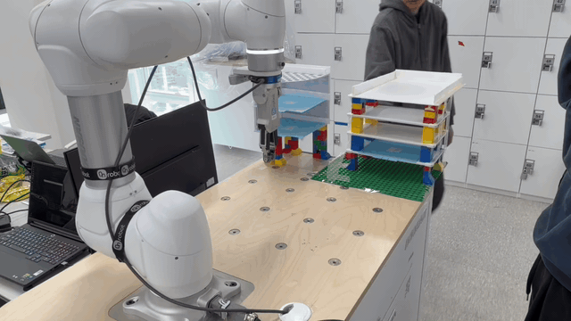
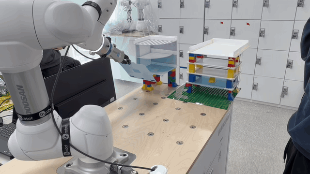
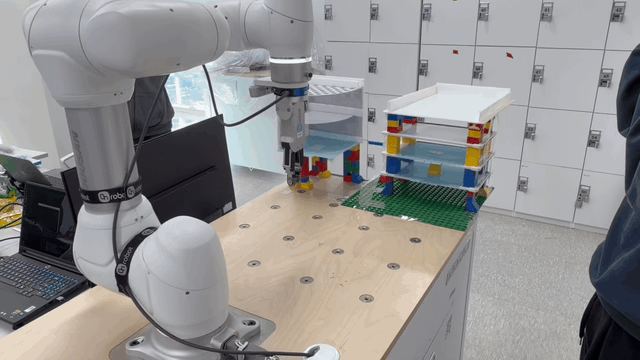
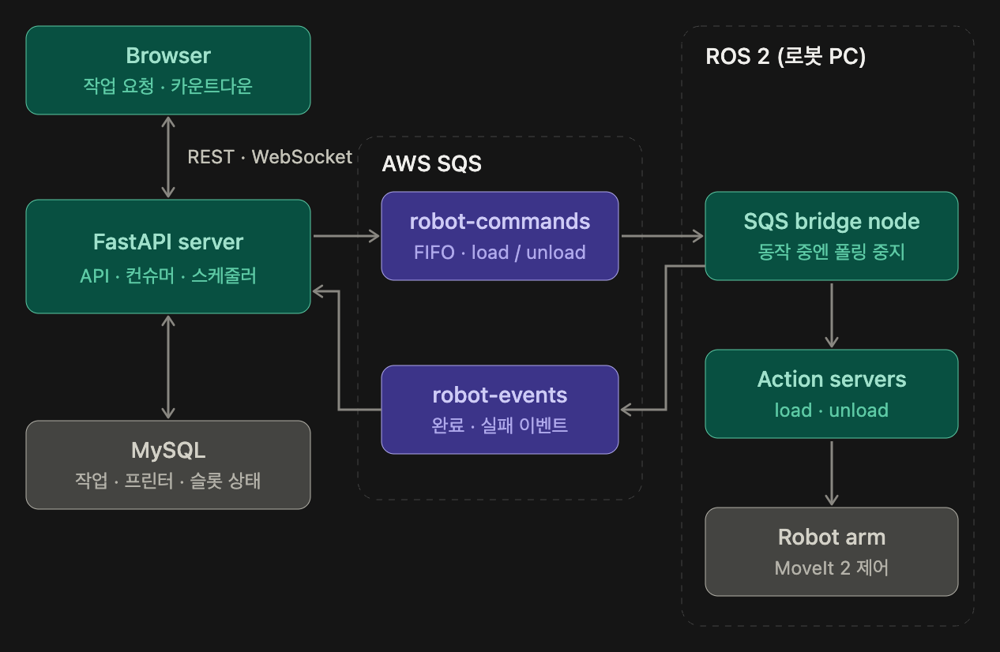
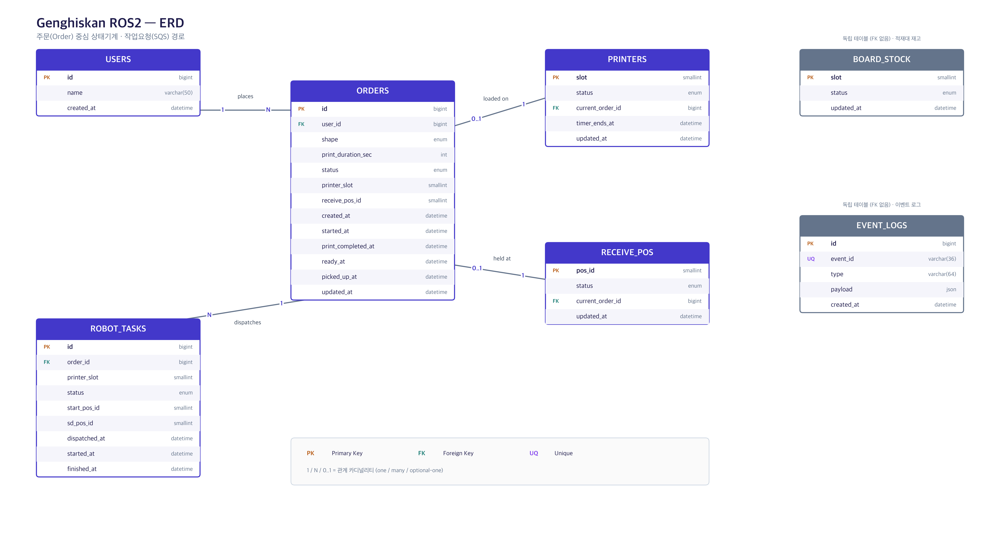

# [두산로보틱스 ROKEY 10기 / 협동-1 / A-2조(징기스칸팀)] <br/> 3Farm Project

<div>


<br/><br/>
</div>


## SKILLS


[](https://v2-manual.scroll.site/ko/v2-programming-manual/2.12.1/publish/drl-basic-syntax)


##  프로젝트 결과


<table align="center">

<tr>
<td align="center"><br/>베드 빼기</td>
<td align="center"><br/>베드 넣기</td>
<td align="center"><br/>출력</td>
</tr>
</table>

<table>
<tr>

</tr>
</table>
   

<br/>
<br/> 


##  프로젝트 소개

```
- 소규모 3D 프린트 업장을 로봇팔 1대가 무인으로 운영합니다.
- 웹 UI를 이용해 두산 로봇팔이 3D 프린터 3대에 보드를 넣고 빼며 주문을 자동으로 처리 합니다.
```

- **기간**: 2026.11.09 ~ 2026.11.20
- **목표**: 
1. 주문 접수 → 보드 투입 → 작업(타이머) → 회수 → 수령까지 무인 처리
2. 보드 부족이나 작업 중 이벤트 등 예외 상황에 대한 대응
3. 로봇의 상태와 작업 처리 상황을 모니터링할 수 있는 웹 대시보드 개발
4. 웹 티칭 팬던트로 로봇팔 원격 조그·그리퍼 제어
5. 3D 뷰어로 로봇팔의 실시간 자세 모니터링

<br/>

### 🐥 용어정리
- **load:** 베드를 집어 작업대(3D 프린터)에 넣는 과정. load1 과 load2 두 단계로 동작이 이루어집니다.
- **unload:** 작업이 완료된 베드를 꺼내 수령대로 옮기는 과정입니다. unload1 과 unload2 두 과정으로 동작이 이루어집니다.

<br/>

### ✨ 핵심 기술 포인트

| 포인트 | 내용 |
|------|------|
| 🧲 힘 센서로 보드 유무 판정 | 적재대에서 보드를 잡은 뒤 로봇팔을 살짝 숙이고 그 전후의 Fz를 비교한다. 기준값보다 크면 보드가 있다고 본다 (예: 2층 실측값은 보드 있음 -10.17N, 없음 -12.70N이라 기준을 -11.4N으로 잡음). |
| 🤏 순응(Compliance) 제어로 슬롯 삽입 | 3D 프린터 슬롯의 마지막 구간은 순응 제어로 밀어 넣는다. 위치 도달과 반력(N)을 함께 확인해서 삽입 완료를 판정한다. |
| 🔁 LOAD/UNLOAD 2단계 분리 | `load1`(잡기 + 보드 확인) → `load2`(프린터에 넣기), `unload1`(프린터에서 빼기) → `unload2`(수령대에 놓기)로 나눠서, 실패한 단계만 다시 시도한다. |
| 📨 SQS 기반 비동기 명령/이벤트 | 서버와 로봇은 `robot-commands`, `robot-events` FIFO 큐로만 통신한다. 로봇이 작업 중일 때 들어온 요청은 대기했다가 `UNLOAD > LOAD` 우선순위로 처리한다. |
| 🔒 로봇 점유(mutex)와 순서 보장 | 로봇이 1대뿐이라 동시에 실행되는 작업은 최대 1개로 제한한다 (`SELECT ... FOR UPDATE`). 먼저 기다린 주문을 새치기하지 않는다. |

<br/>

### 업장 구성
- **로봇**: Doosan M0609 협동로봇 + OnRobot RG2 그리퍼 1대
- **3D 프린터(작업대)**: 3대 · **보드 적재대**: 3층 · **수령대**: 2칸


<br/>
<br/>


##  주요 기능

| 기능 | 설명 |
|------|------|
| 🧾 주문 접수 | 유저 이름, 랜덤 모양, 웹 수동 주문 |
| 🦾 보드 투입 | 빈 프린터가 있을 때만 적재대의 새 보드를 아래층부터 투입 |
| ⏱️ 프린터 타이머 | 보드 투입 완료 시점부터 모양별 출력 시간 카운트 |
| 📦 회수 | 작업 완료된 보드를 꺼내 수령대에 놓기 |
| ⏳ 작업 중 이벤트 대기 | 로봇이 일하는 동안 들어온 이벤트는 SQS(큐)에 쌓였다가 작업이 끝나면 순서대로 처리 |
| 🚨 보드 보충 알럿 | 재고 0이 되면 "보드를 채워주세요" 알럿, 확인 후 재개 |
| 🔍 실물 보드 없음 감지 | 로봇이 적재대의 보드를 못 집으면 주문을 대기중으로 되돌리고 SQS(큐)에 재처리 하도록 다시 큐에 넣는다. |
| 🙋 수령 | 유저가 수령대에서 완성물을 수령해가려면 웹 대시보드에서 수령을 누른다 |
| 🎮 웹 대시보드 | 작업 대기(밀려있는 작업 로그), 3D 프린터 작업대 현황(작업 상태), 수령 대기, 적재대 현황, 수령대 현황, 작업 히스토리 |
| 🕹️ 티칭 팬던트 | 웹에서 로봇팔 조그 이동(관절/좌표)과 그리퍼 열기·닫기. 활성화 전에 안전 확인 모달을 띄우고, 세션 중에는 새 작업요청을 받지 않는다. |
| 🧊 3D 뷰어 | M0609 + RG2 URDF 모델에 실시간 조인트 각도를 반영하고, 작업대·적재대도 함께 표시한다. |
| 📊 SQS 모니터 | `robot-commands`, `robot-events` 큐로 오간 메시지 로그를 확인한다. |
| 🧪 예외 처리 | 예외 상황별 모달로 안내한다. 로봇은 홈으로 돌아와 문제가 해결될 때까지 작업을 멈춘다. |


<br/>


## 🚨 예외처리


| 상황  | 처리 |
|------|------|
| 적재대 재고 0 | "보드를 채워주세요" 알럿. 채우기 완료를 누르면 대기 중인 주문을 바로 다시 발행 |
| 적재대에서 보드 집기 실패 (`load1`) | "적재대의 보드를 확인해 주세요" 알럿. 보드 위치를 바로잡고 확인을 누르면 같은 작업으로 LOAD 재전송 |
| 프린터에 넣기 실패 (`load2`) | "작업대에 잘 들어갔나요?" 확인. 네 → 성공으로 처리하고 진행, 아니오 → 관리자 문의 모달 |
| 프린터에서 빼기 실패 (`unload1`) | "작업대에 보드를 확인하세요!" 알럿. 확인을 누르면 `unload1` 재시도 |
| 수령대 2칸 모두 참 | 수령하기로 자리가 나면 자동으로 닫히고 `unload2` 발행 |

</details>


<br/>
<br/>


### 주문 상태 흐름


<br/>
<br/>

## 🧩 시스템 구조



- **server**: 작업요청·적재대·수령대·티칭 팬던트 API를 제공하고, `robot-commands` SQS 큐로 로봇 명령(load1/load2/unload1/unload2, 조그/그리퍼)을 발행한다.
- **sfarm_bridge**: `robot-commands` 큐를 구독해 ROS 2 액션으로 실행하고, 실행 결과를 `robot-events` 큐로 서버에 돌려준다.
- **sfarm_robot**: 두산 M0609 + OnRobot RG2 그리퍼의 실제 LOAD/UNLOAD 동작을 수행하는 액션 서버.
- **sfarm_joint_streamer**: 로봇 조인트 각도를 `/ws/robot-state` WebSocket으로 스트리밍해 대시보드 3D 뷰어(티칭 팬던트)에 실시간 자세를 반영한다.

로봇과의 통신은 AWS SQS로만 이루어진다 (가상 로봇/시뮬레이터 경로는 제거됨).

<details>
<summary>🗄️ ERD 펼쳐보기</summary>



</details>

<details>
<summary>🧊 3D 뷰어 구조 펼쳐보기</summary>


</details>

<details>
<summary>📦 디렉터리 구성 펼쳐보기</summary>

```
.
├── app/
│   ├── backend/                   # FastAPI 서버 (레이어드 아키텍처: api → services → repositories → models/core)
│   │   └── app/
│   │       ├── api/                # REST 라우터 + /ws/client
│   │       ├── services/           # 작업요청, 적재대/프린터/수령대, SQS 프로듀서/컨슈머, 타이머, 티칭 팬던트 등
│   │       ├── repositories/       # DB 접근 계층
│   │       └── core/               # 설정, DB, 부트스트랩
│   ├── frontend/                   # React + TypeScript + Vite, 아토믹 디자인(atoms~pages) 대시보드
│   ├── ros2_ws/src/
│   │   ├── sfarm_interfaces/       # 커스텀 action / msg
│   │   ├── sfarm_bridge/           # AWS SQS ↔ ROS 2 액션 브릿지 노드
│   │   ├── sfarm_robot/            # 두산 M0609 + OnRobot RG2 로봇팔 동작 실행 노드 (LOAD/UNLOAD)
│   │   └── sfarm_joint_streamer/   # 조인트 상태 → 백엔드 WebSocket 스트리밍 (3D 뷰어용)
│   └── docker-compose.yml          # MySQL 8.0 + backend
├── assets/docs/                     # PRD, WBS, 작업 이력 등 기획 문서
└── README.md
```

</details>

<br/>


## 🚀 시작하기

### 요구 사항
- Docker / Docker Compose
- Python 3.12
- Node.js 20+
- AWS SQS 엔드포인트 2개, region, accessKey, SecretKey
- Ubuntu 24.04, ROS 2 Jazzy, doosan-robot2
- rg2 그리퍼를 포함한 두산 협동로봇 Simulator 설치 (https://github.com/ahnisinc/cobot_rg2.git)


### 웹 빌드 & 실행

실제 구현은 `app/` 아래 있습니다 (`app/backend`, `app/frontend`, `app/ros2_ws`). 처음 클론한 뒤
아래 스크립트 두 개로 실행할 수 있습니다 (자세한 설명·수동 실행 방법은 [`app/README.md`](app/README.md) 참고).

```bash
# 1. 저장소 클론
git clone https://github.com/baeksewoong/genghiskan_ros2.git
cd genghiskan_ros2/app

# 2. 최초 1회 설정 (venv/npm install, .env 생성, MySQL(Docker) 기동, DB 스키마 생성)
./scripts/setup.sh

# 3. 이후 매번 이것만 실행 (Docker 컨테이너 안 떠있으면 기동 + 백엔드·프론트엔드 실행)
./scripts/run_all.sh

# 4. joint streamer => 로봇 동작 시뮬레이터
ros2 run sfarm_joint_streamer joint_streamer --ros-args -p joint_states_topic:=/dsr01/joint_states

```

➡️ 백엔드: http://localhost:8000, 프론트엔드: http://localhost:5173

<br/>


##  트러블슈팅
프로젝트 진행중 마주했던 문제와 해결방법에 대해 정리합니다.
<details>
<summary>❗ 문제 1 — 로봇이 작업 중일 때 들어온 이벤트가 동작 순서를 꼬이게 함</summary>

- **원인**: 베드를 꺼내 작업대에 놓는 과정은 load1, load2 두 단계로 이어진다. load1 수행 중 새로운 이벤트가 들어오면 load2를 이어하지 않고, 이벤트를 받아 다른 동작을 하는 경우가 생겼다.
- **해결**: 이벤트는 DB 상태로만 남기고, 로봇의 작업 결과를 받을 때마다 현재 어떤 동작을 수행하는지 판단하도록 수정.
- **배운 점**: 로봇이 하나뿐이면 "언제 보낼지"를 이벤트가 아니라 상태로 판단해야 순서와 중복을 제어할 수 있다.

</details>

<details>
<summary>❗ 문제 2 — 집기 실패 후 재시도한 명령이 SQS에서 사라짐</summary>

- **원인**: FIFO 큐는 같은 dedup id로 5분 안에 들어온 메시지를 버린다. 재시도가 첫 전송과 같은 `load-{id}`를 쓰고 있었다.
- **해결**: 재시도할 때는 dedup id 뒤에 `uuid.uuid4()`을 붙여서 새 메시지로 보낸다 (`unload1` 재시도도 같은 방식).
- **배운 점**: FIFO 큐의 중복 제거는 "같은 요청"과 "의도적인 재시도"를 구분하지 못하므로, 재시도에는 별도 식별자가 필요하다.

</details>

<details>
<summary>❗ 문제 3 — 프린터 여러 대가 동시에 끝나면 로봇이 완성품을 든 채 다음 명령을 받음</summary>

- **원인**: 타이머 스윕이 출력이 끝난 프린터마다 `unload1`을 즉시 발행했다. 빈 프린터가 없는데도 `load1`을 보내서, 보드를 집고도 놓을 곳이 없어 멈추는(deadlock) 경우도 있었다.
- **해결**: `dispatch_pending_robot_work`가 한 번에 하나씩만 발행하도록 바꾸고, 빈 프린터가 없으면 `load1` 자체를 보류하는 가드를 추가했다.
- **배운 점**: 명령을 보내기 전에 "이 명령을 끝까지 수행할 자리가 있는지"까지 확인해야 물리 시스템이 멈추지 않는다.

</details>

<details>
<summary>❗ 문제 4 — 그리퍼가 닫혀도 보드를 실제로 잡았는지 알 수 없음</summary>

- **원인**: 적재대에 보드가 없어도 그리퍼는 정상적으로 닫히기 때문에, 그리퍼 상태만으로는 집기 성공 여부를 알 수 없었다.
- **해결**: 잡은 뒤 로봇팔을 살짝 숙이고(기본 9°, 2층은 10°) 그 전후의 Fz를 비교한다. 층마다 보드가 있을 때와 없을 때의 Fz를 실측해서 기준값을 정했다 (`grip_and_check`, `TILT_CHECK_FZ_BY_LAYER`).
- **배운 점**: 별도 센서 없이도 로봇의 힘/토크 센서로 무게 차이를 읽어 물체 유무를 판정할 수 있다. 기준값은 층(자세)마다 달라서 실측이 꼭 필요하다.

</details>

<details>
<summary>❗ 문제 5 — 프린터 슬롯에 보드를 넣을 때 걸리거나 과하게 밀림</summary>

- **원인**: 위치 제어만으로 밀어 넣으면 슬롯과 조금만 어긋나도 걸리고, 끝까지 들어갔는지 알 수 없었다.
- **해결**: 처음 구간은 위치 제어로 빠르게 다가가고, 마지막 구간은 순응(compliance) 제어로 밀어 넣는다. 위치 도달과 반력을 함께 확인해서 완료를 판정한다.
- **배운 점**: 접촉이 있는 작업은 위치 제어와 힘 제어를 구간별로 나눠 쓰면 정확성과 안정성을 둘 다 얻을 수 있다.

</details>

   
      
<br/>
<br/>


##  팀원 소개

<div align="center">

| | 이름 | 역할 |
|:---:|:---|:---|
|  | [남&#8288;규&#8288;진](https://github.com/skarbwls419-art) | ROS 2 모듈 개발 / launch.py 파일 작성 및 통합 테스트 QA |
|  | [백&#8288;세&#8288;웅](https://github.com/tpdnd16-jpg) | 로봇 팔 동작 구현을 위한 ROS2 컨슈머 구현 (LOAD / UNLOAD) |
|  | [최&#8288;희&#8288;범](https://github.com/kcodeusers) | 로봇 팔 동작 구현을 위한 ROS2 컨슈머 구현 (LOAD / UNLOAD) |
|  | [나&#8288;연&#8288;수](https://github.com/I-Am-Na) | 아이디어 기획/ 웹서버와 ROS2 node의 통신 노드 개발 / 인터페이스 정의 / 디지털 트윈 모듈 개발 / 프로젝트 발표 |
|  | [류&#8288;병&#8288;옥](https://github.com/devrereg) | 시스템 아키텍쳐 설계 / 웹 개발 / 로봇 디지털 트윈 / 웹 티칭펜던트 구현으로 정밀 좌표 추출 | 

</div>


<div align="center">


**⭐ 감사합니다!**

</div>