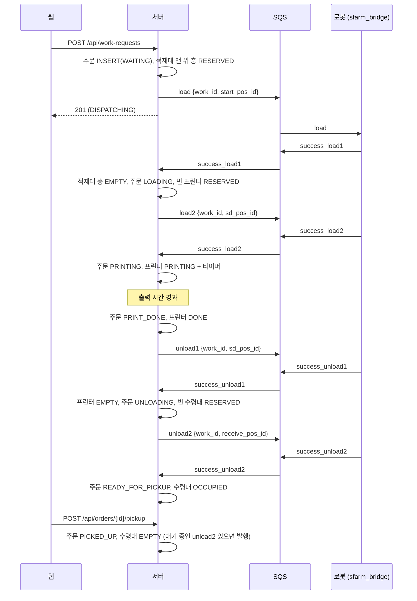

# PRD — 작업요청(SQS 디스패치) 기능

작성일: 2026-11-14 · 작성자: 류병옥 (Claude 보조 작성) · 개정: 2026-11-18

관련 문서: [`prd.md`](prd.md)(전체 PRD), [`prd-teaching-pendant.md`](prd-teaching-pendant.md)(티칭 팬던트), `app/ros2_ws/src/sfarm_bridge`(ROS 2 쪽 SQS 브릿지)

> **2026-11-18 개정:** UNLOAD 2단계(unload1/unload2)와 수령대(`receive_pos`) 관리를 추가하고, 가상 로봇(`/ws/bridge`) 경로가 제거된 현재 구조에 맞춰 전체를 다시 썼다. 이전 판의 `pick_complete` 이벤트, "두 경로 병행" 논의, `board_inventory` 관련 내용은 더 이상 유효하지 않다 (12장 변경 이력 참고).

## 1. 목적과 범위

웹에서 **작업요청**을 넣으면 서버가 적재대를 확인해 로봇에 SQS로 명령을 보내고, 로봇이 단계마다 보내는 결과 이벤트에 따라 다음 명령을 이어 보낸다. 베드를 적재대에서 집어 프린터에 넣고(LOAD 2단계), 출력이 끝나면 꺼내서 수령대에 놓는(UNLOAD 2단계) 전체 흐름을 다룬다. 주문은 이 경로로만 만들어진다.

범위 밖: 로그인·결제, 실제 출력(프린터는 서버 타이머), 티칭 팬던트(별도 PRD).

### 용어

| 용어 | 뜻 |
| --- | --- |
| 베드 | 프린터에 넣는 출력판. 주문 1건 = 베드 1장 |
| 적재대 (`board_stock`) | 새 베드를 쌓는 3층 선반. 로봇은 맨 위(번호가 큰 층)부터 집는다 |
| 수령대 (`receive_pos`) | 완성품을 놓는 2칸. 빈 칸 중 1번부터 채운다 |
| 투입중 (`DISPATCHING`) | load 발행 후 success_load1을 받기 전까지의 주문 상태 |
| robot-commands | 서버 → 로봇 SQS FIFO 큐 (`robot-commands.fifo`) |
| robot-events | 로봇 → 서버 SQS 큐 |

## 2. 사용자 흐름 (웹 대시보드)

1. **작업요청** 폼에 손님 이름과 모양(세모/네모/별/동그라미, 미선택 시 랜덤)을 넣고 "요청하기".
2. 성공하면 주문이 진행 목록에 나타나고, 적재대·프린터·수령대 현황 패널이 실시간으로 바뀐다.
3. 적재대가 비어 있으면 폼에 에러가 뜨고 "적재대에 베드가 비어있습니다" 모달이 뜬다. 베드를 채운 뒤 "채우기 완료"를 누른다.
4. 완성품이 수령대에 놓이면 수령대 패널의 해당 칸에 **수령하기** 버튼이 생긴다.
5. 실패나 수령대 가득 참이 생기면 모달 알럿이 뜬다 (6장).

## 3. 전체 흐름

### 단계별 서버 처리

| 트리거 | 서버 처리 | 다음 명령 |
| --- | --- | --- |
| 작업요청 | 주문 INSERT(WAITING) 커밋 → 조그 세션 중이면 여기서 멈춤(WAITING 유지) → 적재대 맨 위 OCCUPIED 층을 RESERVED, robot_tasks(LOAD, DISPATCHED) 생성, 주문 DISPATCHING | load |
| success_load1 | 적재대 층 EMPTY, 주문 LOADING, 작업 RUNNING을 먼저 커밋 → 빈 프린터(번호 작은 쪽) RESERVED, 주문·작업에 프린터 배정 | load2 |
| success_load2 | 작업 SUCCEEDED, 주문 PRINTING(started_at), 프린터 PRINTING(timer_ends_at) | — |
| 타이머 만료 | 주문 PRINT_DONE(print_completed_at), 프린터 DONE | unload1 |
| success_unload1 | 주문 UNLOADING, 프린터 EMPTY를 먼저 커밋 → 빈 수령대(1번 우선) RESERVED, 주문에 receive_pos_id 기록 | unload2 |
| success_unload2 | 주문 READY_FOR_PICKUP(ready_at), 수령대 OCCUPIED | — |
| 수령하기 | 주문 PICKED_UP(picked_up_at), 수령대 EMPTY → 수령대 자리를 기다리던 주문이 있으면 가장 오래 기다린 것부터 | unload2 |

원칙:
- **물리적 사실은 먼저 커밋한다.** success_load1·success_unload1처럼 로봇이 이미 무언가를 옮긴 경우, 다음 명령의 발행 성공 여부와 상관없이 적재대·프린터 상태를 먼저 확정한다.
- **명령 발행과 예약은 한 트랜잭션이다.** 발행에 실패하면 그 단계의 예약(적재대 층, 프린터, 수령대)을 롤백한다.
- **중복·알 수 없는 이벤트는 조용히 무시한다.** 각 핸들러는 주문이 기대하는 상태일 때만 처리한다.

## 4. 기능 요구사항

| ID | 기능 | 상세 | 우선순위 |
| --- | --- | --- | --- |
| WR-01 | 작업요청 | 손님 이름 + 모양으로 주문 생성, 그 요청 안에서 적재대 확인 후 load 발행 | P0 |
| WR-02 | 적재대 비어있음 처리 | 409 + `alert.refill_required(BOARD_STOCK_EMPTY)`, 주문은 WAITING 유지 | P0 |
| WR-03 | 채우기 완료 | EMPTY 층을 모두 OCCUPIED로, 알럿 해제 | P0 |
| WR-04 | LOAD 2단계 | success_load1 → 빈 프린터 배정 후 load2, success_load2 → 출력 시작 | P0 |
| WR-05 | 출력 완료 | 타이머 만료 시 PRINT_DONE + unload1 발행 | P0 |
| WR-06 | UNLOAD 2단계 | success_unload1 → 프린터 비움 + 빈 수령대 배정 후 unload2, success_unload2 → 수령 대기 | P0 |
| WR-07 | 수령대 가득 참 | 알럿 + 대기, 수령하기로 자리가 나면 unload2 자동 발행 | P0 |
| WR-08 | 수령하기 | 수령대 칸의 버튼으로 PICKED_UP, 수령대 비움 | P0 |
| WR-09 | 실패 알럿·재시도 | fail_load1 / fail_unload1 알럿, "확인" 시 같은 명령 재발행 | P0 |
| WR-10 | 실시간 반영 | 상태가 바뀔 때마다 /ws/client로 브로드캐스트 | P0 |
| WR-11 | 발행 실패 복구 | 예약 롤백, 작업요청이면 502 | P1 |

## 5. 데이터 모델

전체 테이블은 [`prd.md`](prd.md) 6장 참고. 이 기능이 쓰는 핵심 테이블:

### board_stock — 적재대 (1~3층)

| 컬럼 | 타입 | 설명 |
| --- | --- | --- |
| slot | SMALLINT PK | 1(아래)~3(위) |
| status | ENUM('EMPTY','RESERVED','OCCUPIED') | RESERVED = load 발행 후 로봇이 아직 집기 전 |
| updated_at | DATETIME | |

OCCUPIED → RESERVED(load 발행) → EMPTY(success_load1) → OCCUPIED(채우기 완료). 초기값은 모두 EMPTY.

### receive_pos — 수령대 (1~2칸)

| 컬럼 | 타입 | 설명 |
| --- | --- | --- |
| pos_id | SMALLINT PK | 1~2 |
| status | ENUM('EMPTY','RESERVED','OCCUPIED') | RESERVED = unload2 발행 후 로봇이 가져오는 중 |
| current_order_id | BIGINT NULL FK → orders.id | |
| updated_at | DATETIME | |

EMPTY → RESERVED(unload2 발행) → OCCUPIED(success_unload2) → EMPTY(수령하기). 수령대 점유 판단은 이 테이블만 본다. `orders.receive_pos_id`는 "어느 칸에 놓였었는지" 이력용이다.

**수령대 대기 상태:** 주문이 UNLOADING인데 `receive_pos_id`가 NULL이면 "로봇이 완성품을 들고 수령대 자리를 기다리는 중"이다. 수령하기 직후 이 조건의 주문을 `updated_at` 순으로 하나 골라 unload2를 보낸다.

### robot_tasks — LOAD 작업

load 발행 시 생성(DISPATCHED, start_pos_id) → success_load1(RUNNING, printer_slot 배정) → success_load2(SUCCEEDED). unload는 기록하지 않는다. 진행 중 작업이 있으면 티칭 팬던트 세션을 켤 수 없다.

### orders.status

WAITING → DISPATCHING → LOADING → PRINTING → PRINT_DONE → UNLOADING → READY_FOR_PICKUP → PICKED_UP

## 6. 예외 처리

| 상황 | 감지 | 처리 | 웹 |
| --- | --- | --- | --- |
| 적재대 비어있음 | 작업요청 시 OCCUPIED 층 없음 | 주문 WAITING 유지, 409 | `alert.refill_required` → "채우기 완료" 모달 |
| 베드 집기 실패 | `fail_load1` | 상태 변경 없음 (적재대 층 RESERVED, 주문 DISPATCHING 유지) | `alert.load_pick_failed` → "적재대의 베드를 확인해 주세요". "확인" = `POST /retry-load` |
| 완성품 집기 실패 | `fail_unload1` | 상태 변경 없음 (주문 PRINT_DONE 유지) | `alert.unload_pick_failed` → "작업대에 베드를 확인하세요!". "확인" = `POST /retry-unload` |
| 수령대 가득 참 | success_unload1 시 EMPTY 칸 없음 | 주문 UNLOADING + 수령대 미배정으로 대기 | `alert.receive_pos_full` → 수령하기로 자리가 나면 unload2 발행 + `alert.receive_pos_full_cleared`로 모달 자동 닫힘 |
| 빈 프린터 없음 | success_load1 시 EMPTY 프린터 없음 | 로그만 남김 (자동 재시도 없음, 10장) | — |
| 조그 세션 중 작업요청 | 세션 활성 | load 보류, 주문 WAITING, 201 | — |
| SQS 발행 실패 | boto3 오류 또는 큐 URL 미설정 | 해당 단계 예약 롤백. 작업요청이면 502 | `sqs.command_failed` / `sqs.command_skipped` |
| 중복·알 수 없는 이벤트 | 주문 상태 불일치 | 무시 | — |

**재시도와 FIFO 중복 제거:** FIFO 큐는 같은 MessageDeduplicationId로 5분 안에 다시 온 메시지를 버린다. 재시도(retry-load, retry-unload)는 dedup id 뒤에 재시도 토큰을 붙여(`load-42-ab12...`) 첫 전송과 겹치지 않게 한다.

## 7. API 명세

| 메서드 | 경로 | 요청 | 응답 |
| --- | --- | --- | --- |
| POST | /api/work-requests | `{ "customer_name": "홍길동", "shape": "STAR" }` (shape null이면 랜덤) | 201 `OrderOut` (DISPATCHING, 또는 조그 세션 중이면 WAITING) / 409 `{error_code: "BOARD_EMPTY"}` / 502 `{error_code: "SQS_PRODUCE_FAILED"}` |
| POST | /api/work-requests/{work_id}/retry-load | — | 200 / 404 `LOAD_TASK_NOT_FOUND` / 502 |
| POST | /api/work-requests/{work_id}/retry-unload | — | 200 / 404 `UNLOAD_TASK_NOT_FOUND` / 502 |
| POST | /api/orders/{order_id}/pickup | — | 200 `OrderOut` / 404 `ORDER_NOT_PICKUPABLE` |
| GET | /api/board-stock | — | 적재대 3층 |
| POST | /api/board-stock/refill-complete | — | 갱신된 적재대 3층 |
| GET | /api/receive-pos | — | 수령대 2칸 |
| POST | /api/sqs/commands/unload2 | `{ "work_id": 2, "receive_pos_id": 1 }` | 200 `{sent, body}` / 422(잘못된 값) / 502 `SQS_PRODUCE_FAILED`. **테스트·ROS 2 연동 확인용 수동 발행** — 주문·수령대 상태는 바꾸지 않고, 호출마다 dedup id에 토큰을 붙여 매번 실제로 발행된다 |

## 8. SQS 인터페이스

### robot-commands.fifo (서버 → 로봇)

모든 LOAD/UNLOAD 계열 명령은 MessageGroupId `"load"` 하나로 묶어 로봇이 한 번에 하나씩 순서대로 처리하게 한다.

| 명령 | body | MessageDeduplicationId |
| --- | --- | --- |
| load | `{ "work_id": 42, "start_pos_id": 3 }` | `load-42` |
| load2 | `{ "type": "load2", "work_id": 42, "sd_pos_id": 1 }` | `place-42` |
| unload1 | `{ "type": "unload1", "work_id": 42, "sd_pos_id": 1 }` | `unload-42` |
| unload2 | `{ "type": "unload2", "work_id": 42, "receive_pos_id": 1 }` | `unload2-42` |

- `work_id` = `orders.id`
- `start_pos_id` = 적재대 층(1~3), `sd_pos_id` = 프린터(1~3), `receive_pos_id` = 수령대(1 또는 2)
- 같은 work_id라도 단계마다 dedup prefix가 달라 서로를 중복으로 보지 않는다.

### robot-events (로봇 → 서버)

`{ "work_id": 42, "type": "<이벤트>" }`

| type | 의미 | 서버 처리 |
| --- | --- | --- |
| success_load1 | 적재대에서 베드 집기 성공 | 3장 표 |
| success_load2 | 프린터에 배치 성공 | 3장 표 |
| fail_load1 | 베드 집기 실패 | 6장 |
| success_unload1 | 프린터에서 완성품 꺼내기 성공 | 3장 표 |
| success_unload2 | 수령대에 놓기 성공 | 3장 표 |
| fail_unload1 | 완성품 집기 실패 | 6장 |

`fail_load2`, `fail_unload2`는 ROS 2 쪽에 정의돼 있지만 서버는 아직 처리하지 않는다 (10장).

### 환경

백엔드 `.env`에 `COMMAND_QUEUE_URL`, `EVENT_QUEUE_URL`, `AWS_REGION`과 AWS 자격증명이 필요하다. 큐 URL이 비어 있으면 발행·수신이 조용히 비활성화된다 (테스트는 항상 빈 값).

## 9. 비기능 요구사항

| 항목 | 기준 |
| --- | --- |
| 응답 시간 | 작업요청은 SQS 발행까지 포함해 1초 이내 |
| 동시성 | 적재대·프린터·수령대·주문 행은 `SELECT ... FOR UPDATE`로 잠그고 배정 |
| 추적성 | SQS 송수신은 웹 이벤트(`sqs.*`)로 event_logs에 남고 SQS 모니터 페이지에서 확인. robot_tasks에 발행 당시 start_pos_id/sd_pos_id 보존 |

## 10. 미결 사항

- [ ] **고정값 발행:** load의 `start_pos_id`, load2·unload1의 `sd_pos_id`가 테스트용으로 3으로 고정 발행된다 (서버 DB에는 실제 층/슬롯이 기록됨). ROS 2 좌표 정리 후 실제 값으로 바꾼다.
- [ ] **ROS 2 쪽 unload2:** `sfarm_bridge`가 unload2의 `receive_pos_id`를 아직 읽지 않는다.
- [ ] WAITING으로 남은 주문(적재대 비어 있음, 조그 세션 중)을 채우기 완료나 세션 종료 시 자동으로 다시 발행할지.
- [ ] success_load1 시 빈 프린터가 없으면 멈춘다. 프린터가 빌 때(success_unload1) load2를 자동 발행할지.
- [ ] 로봇 응답이 오지 않는 단계를 감지하는 타임아웃.
- [ ] `fail_load2`, `fail_unload2` 처리 (알럿 문구, 재시도 대상).
- [ ] AWS 자격증명 관리 방식 (로컬 vs 배포).

## 11. 구현 현황 (2026-11-18)

- **백엔드:** `services/work_request_service.py`(작업요청, 단계별 이벤트 처리, 수령대 배정·대기, 재시도), `sqs_producer_service.py`(load/load2/unload1/unload2/조그/그리퍼 발행, 재시도 토큰), `sqs_consumer_service.py`(robot-events 분기), `timer_service.py`(출력 완료 → unload1), `order_service.py`(수령하기 → 수령대 비움 → 대기 unload2 재개), `board_stock_service.py`, `repositories/receive_pos_repository.py`. 마이그레이션 0002~0010.
- **프론트:** 작업요청 폼, `BoardStockPanel`, `PrinterPanel`, `ReceivePosPanel`(수령하기 포함), 알럿 모달(`BoardStockRefillModal`, `LoadPickFailedModal`, `UnloadPickFailedModal`, `ReceivePosFullModal`).
- **테스트:** `tests/test_work_request.py`, `test_work_request_api.py`, `test_timer_service.py`, `test_order_service.py` 등 백엔드 62건 통과.
- **미커밋:** 2026-11-18 작업분(UNLOAD 2단계, 수령대, 가상 로봇 제거)은 아직 커밋 전이다.

## 12. 변경 이력

| 날짜 | 내용 |
| --- | --- |
| 2026-11-14 | 초판. 작업요청 → load 발행, `board_stock` 신설(층 모델, 수량 입력 없는 "채우기 완료"). 알럿 reason을 `BOARD_STOCK_EMPTY`로 분리 (기존 수량 입력 모달이 잘못 뜨는 문제 방지) |
| 2026-11-16 | 이벤트 이름을 `pick_complete`에서 `success_load1`/`fail_load1`로 변경. 프린터 배정을 dispatch 시점에서 success_load1 시점으로 미룸(load2 신설). `success_load2` → PRINTING 추가. `board_inventory` 제거. 가상 로봇 디스패처가 작업요청 주문을 가로채던 버그 수정 |
| 2026-11-18 | UNLOAD 2단계(unload1/unload2), `receive_pos` 테이블, 수령대 가득 참 대기·자동 재개, fail_unload1 알럿·재시도, success_unload1 시 프린터 비움. 재시도 dedup 버그 수정(재시도가 첫 전송과 같은 dedup id를 써서 5분 내 버려질 수 있었음). 가상 로봇(`/ws/bridge`)·수동 주문·`orders.source`·`robot_tasks.type`·`event_logs.direction`·`orders.pickup_delay_sec`·`robot_tasks.last_phase/error_code`·`printers.status` UNLOADING 값 제거 |
