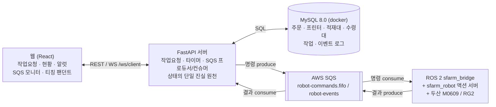
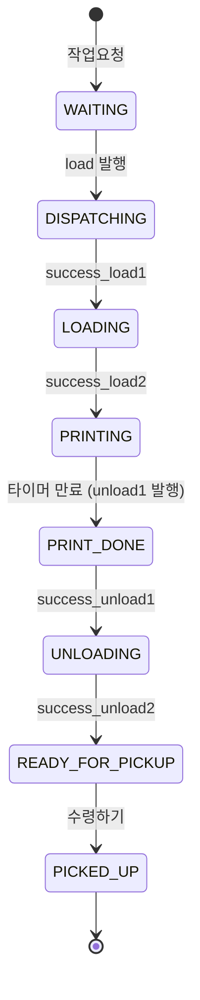

# PRD — 소규모 3D 프린트 업장 관리 로봇

작성일: 2026-11-12 · 작성자: 류병옥 · 개정: 2026-11-18

> **2026-11-18 개정:** 가상 로봇(`virtual-robot`, `/ws/bridge`) 단계를 끝내고 실물 로봇 + AWS SQS 구조로 정리했다. 자동 주문(45초 스케줄러), 디스패처, 시뮬레이터(시간 배율), 장애 주입, 2D 로봇팔 애니메이션은 모두 제거됐다. 세부 기능은 아래 두 문서가 기준이다.
> - 작업요청·LOAD/UNLOAD·적재대·수령대: [`prd-work-request-sqs.md`](prd-work-request-sqs.md)
> - 티칭 팬던트(조그·그리퍼): [`prd-teaching-pendant.md`](prd-teaching-pendant.md)

## 1. 개요

두산 로보틱스 M0609 로봇팔 1대가 3D 프린터 3대를 관리하는 업장을 운영한다. 서버(FastAPI)가 주문·프린터·적재대·수령대 상태의 단일 진실 원천이며, 로봇에게는 AWS SQS로 단계별 명령을 하나씩 보내고 결과 이벤트를 받아 다음 단계를 진행한다.

### 목표

- 웹에서 작업요청을 넣으면 적재대에서 베드를 집어 빈 프린터에 넣고, 출력이 끝나면 꺼내서 빈 수령대에 놓는 전체 흐름을 자동으로 진행한다.
- 베드 없음, 집기 실패, 수령대 가득 참 같은 예외를 웹 알럿으로 알리고, 사람이 확인하면 이어서 진행한다.
- 실물 로봇 좌표를 웹 티칭 팬던트로 확인·조정할 수 있다.

### 범위 밖

- 실제 3D 프린팅 (프린터는 서버 타이머로 동작하는 가상 장치)
- 로그인·결제·다중 매장
- 손님의 실제 수령 감지 (사람이 웹에서 "수령하기"를 누른다)

### 용어

| 용어 | 뜻 |
| --- | --- |
| 베드 | 프린터에 넣는 출력판. 주문 1건 = 베드 1장 |
| 적재대 | 새 베드를 쌓아두는 곳. 3층, 로봇은 맨 위(번호가 큰 층)부터 집는다 |
| 프린터 슬롯 | 프린터 3대 (1~3번). 빈 곳 중 번호가 작은 쪽부터 채운다 |
| 수령대 | 완성품을 놓는 곳. 2칸, 빈 곳 중 1번부터 채운다 |
| load / load2 | 적재대에서 베드 집기 / 집은 베드를 프린터에 넣기 |
| unload1 / unload2 | 프린터에서 완성품 꺼내기 / 꺼낸 완성품을 수령대에 놓기 |
| robot-commands | 서버 → 로봇 명령 SQS FIFO 큐 |
| robot-events | 로봇 → 서버 결과 SQS 큐 |
| sfarm_bridge | SQS와 ROS 2 액션을 잇는 ROS 2 노드 (`app/ros2_ws`) |

## 2. 시스템 구성



| 컴포넌트 | 책임 | 하지 않는 것 |
| --- | --- | --- |
| 웹 (React) | 작업요청, 적재대·프린터·수령대 현황, 알럿 처리, 수령하기, SQS 모니터, 티칭 팬던트 | 상태 판단, 타이머 계산 |
| FastAPI 서버 | 주문 저장, 단계별 명령 발행, robot-events 처리, 프린터 타이머, 적재대·수령대 배정, 웹 이벤트 송신 | 로봇 모션 |
| MySQL | 모든 상태와 이력 저장 | |
| sfarm_bridge / sfarm_robot | SQS 명령 → ROS 2 액션 실행 → 결과를 robot-events로 송신 | 다음 작업 선택, DB 접근 |

## 3. 업무 규칙

### 주문

| 모양 | 코드 | 출력 시간 |
| --- | --- | --- |
| 세모 | TRIANGLE | 30초 |
| 네모 | SQUARE | 40초 |
| 별 | STAR | 50초 |
| 동그라미 | CIRCLE | 70초 |

- 주문은 웹의 **작업요청**으로만 만든다 (손님 이름 + 모양, 모양 미선택 시 랜덤). 자동 주문은 없다.
- 주문은 생성 즉시 DB에 INSERT(WAITING)되고, 그 요청 안에서 바로 적재대를 확인해 load를 발행한다 (상시 재평가 루프 없음).

### 단계별 진행

1. **작업요청** → 적재대 맨 위 OCCUPIED 층을 예약(RESERVED) → `load` 발행 → 주문 DISPATCHING
2. **success_load1** → 적재대 층 비움(EMPTY), 주문 LOADING → 빈 프린터(번호 작은 쪽)를 예약 → `load2` 발행
3. **success_load2** → 주문 PRINTING, 프린터 PRINTING + 출력 타이머 시작
4. **타이머 만료** → 주문 PRINT_DONE, 프린터 DONE → `unload1` 발행
5. **success_unload1** → 프린터 비움(EMPTY), 주문 UNLOADING → 빈 수령대(1번 우선)를 예약 → `unload2` 발행
6. **success_unload2** → 주문 READY_FOR_PICKUP, 수령대 OCCUPIED
7. **수령하기** (웹) → 주문 PICKED_UP, 수령대 비움 → 수령대 자리를 기다리던 완성품이 있으면 `unload2` 자동 발행

### 예외

| 상황 | 처리 |
| --- | --- |
| 적재대가 비어 있음 | 주문은 WAITING으로 남고 409 응답 + "적재대에 베드가 비어있습니다" 알럿. 사람이 채우고 "채우기 완료"를 누르면 EMPTY 층이 모두 OCCUPIED가 된다 |
| 베드 집기 실패 (`fail_load1`) | 상태는 그대로, "적재대의 베드를 확인해 주세요" 알럿. "확인" 시 load 재발행 |
| 완성품 집기 실패 (`fail_unload1`) | 상태는 그대로, "작업대에 베드를 확인하세요!" 알럿. "확인" 시 unload1 재발행 |
| 수령대 2칸이 모두 참 | 주문은 UNLOADING(수령대 미배정)으로 대기, "수령대가 가득 찼습니다" 알럿. 수령하기로 자리가 나면 unload2 자동 발행 |
| 티칭 팬던트 조그 세션 중 작업요청 | load를 보내지 않고 주문을 WAITING으로 남긴다 (201) |
| SQS 발행 실패 | 해당 단계의 예약을 롤백한다 (작업요청이면 502) |

재시도 명령은 FIFO 중복 제거(5분)에 걸리지 않도록 MessageDeduplicationId에 재시도 토큰을 붙인다.

## 4. 상태 머신



| 대상 | 상태 흐름 |
| --- | --- |
| 프린터 | EMPTY → RESERVED(load2 발행) → PRINTING(success_load2) → DONE(타이머 만료) → EMPTY(success_unload1) |
| 적재대 층 | OCCUPIED → RESERVED(load 발행) → EMPTY(success_load1) → OCCUPIED(채우기 완료) |
| 수령대 칸 | EMPTY → RESERVED(unload2 발행) → OCCUPIED(success_unload2) → EMPTY(수령하기) |

## 5. 기능 요구사항

| ID | 기능 | 상세 | 우선순위 |
| --- | --- | --- | --- |
| FR-01 | 작업요청 | 손님 이름 + 모양(랜덤 가능)으로 주문 생성, 즉시 load 발행 | P0 |
| FR-02 | 적재대 관리 | 3층 상태 표시, 비면 알럿, "채우기 완료"로 일괄 채움 | P0 |
| FR-03 | LOAD 2단계 | load → success_load1 → 빈 프린터 배정 후 load2 → success_load2 | P0 |
| FR-04 | 프린터 타이머 | success_load2 시 시작, 만료 시 PRINT_DONE + unload1 발행 | P0 |
| FR-05 | UNLOAD 2단계 | unload1 → success_unload1(프린터 비움) → 빈 수령대 배정 후 unload2 → success_unload2 | P0 |
| FR-06 | 수령대 관리 | 2칸 현황 표시(손님·모양·완료 시각), 수령하기 버튼, 가득 참 알럿, 자리 나면 자동 재개 | P0 |
| FR-07 | 실패 알럿·재시도 | fail_load1 / fail_unload1 알럿, "확인" 시 같은 명령 재발행 | P0 |
| FR-08 | 상태 스냅샷·실시간 갱신 | 웹 접속 시 스냅샷, 이후 /ws/client 이벤트로 갱신 | P0 |
| FR-09 | SQS 모니터 | 큐 상태, 발행·수신 메시지 히스토리 | P1 |
| FR-10 | 티칭 팬던트 | 조그 세션, 스텝 조그, 그리퍼 개폐, 정지 ([`prd-teaching-pendant.md`](prd-teaching-pendant.md)) | P1 |
| FR-11 | 통계 | 처리 건수, 평균 대기·출력·수령 시간 | P1 |

## 6. 데이터 모델 (MySQL 8.0)

모든 시각은 DATETIME에 UTC로 저장하고 웹에서 KST로 변환해 보여준다. DB 세션 time_zone은 '+00:00'으로 고정한다. 런칭 전이므로 스키마 변경 시 DB는 `app/scripts/reset_db.sql`로 초기화해서 쓴다.

### users — 손님

| 컬럼 | 타입 | 설명 |
| --- | --- | --- |
| id | BIGINT PK AI | |
| name | VARCHAR(50) | 작업요청 시 입력한 이름 (미입력 시 손님-0000 형식) |
| created_at | DATETIME | |

### orders — 주문

| 컬럼 | 타입 | 설명 |
| --- | --- | --- |
| id | BIGINT PK AI | SQS 메시지의 work_id |
| user_id | BIGINT FK → users.id | |
| shape | ENUM('TRIANGLE','SQUARE','STAR','CIRCLE') | |
| print_duration_sec | INT | 주문 시점의 출력 시간 |
| status | ENUM('WAITING','DISPATCHING','LOADING','PRINTING','PRINT_DONE','UNLOADING','READY_FOR_PICKUP','PICKED_UP') | 4장 상태 머신 |
| printer_slot | SMALLINT NULL | 배정된 프린터 (success_load1 이후) |
| receive_pos_id | SMALLINT NULL | 배정된 수령대 (이력용, 현재 점유는 receive_pos 테이블 기준) |
| created_at / started_at / print_completed_at / ready_at / picked_up_at | DATETIME | 요청 / 출력 시작 / 출력 완료 / 수령대 도착 / 수령 시각 |
| updated_at | DATETIME | |

### printers — 프린터 (1~3)

| 컬럼 | 타입 | 설명 |
| --- | --- | --- |
| slot | SMALLINT PK | 1~3 |
| status | ENUM('EMPTY','RESERVED','PRINTING','DONE') | |
| current_order_id | BIGINT NULL FK | |
| timer_ends_at | DATETIME NULL | 출력 종료 예정 시각 |
| updated_at | DATETIME | |

### board_stock — 적재대 (1~3층)

| 컬럼 | 타입 | 설명 |
| --- | --- | --- |
| slot | SMALLINT PK | 1~3 (3 = 맨 위) |
| status | ENUM('EMPTY','RESERVED','OCCUPIED') | |
| updated_at | DATETIME | |

### receive_pos — 수령대 (1~2칸)

| 컬럼 | 타입 | 설명 |
| --- | --- | --- |
| pos_id | SMALLINT PK | 1~2 |
| status | ENUM('EMPTY','RESERVED','OCCUPIED') | |
| current_order_id | BIGINT NULL FK | |
| updated_at | DATETIME | |

### robot_tasks — LOAD 작업 기록

| 컬럼 | 타입 | 설명 |
| --- | --- | --- |
| id | BIGINT PK AI | |
| order_id | BIGINT FK | |
| printer_slot | SMALLINT NULL | success_load1 이후 배정 |
| status | ENUM('DISPATCHED','RUNNING','SUCCEEDED','FAILED','CANCELED') | |
| start_pos_id / sd_pos_id | SMALLINT NULL | 집은 적재대 층 / 배치한 프린터 |
| dispatched_at / started_at / finished_at | DATETIME NULL | |

unload 단계는 robot_tasks에 기록하지 않고 주문·프린터·수령대 상태로만 추적한다. 진행 중(DISPATCHED/RUNNING) 작업이 있으면 티칭 팬던트 세션을 켤 수 없다.

### event_logs — 웹 이벤트 기록

| 컬럼 | 타입 | 설명 |
| --- | --- | --- |
| id | BIGINT PK AI | |
| event_id | CHAR(36) UNIQUE | 메시지 봉투의 UUID |
| type | VARCHAR(64) | 7.3 이벤트 타입 |
| payload | JSON | |
| created_at | DATETIME | |

화면 표기:

| orders.status | 화면 표기 |
| --- | --- |
| WAITING | 대기중 |
| DISPATCHING | 투입중 |
| LOADING, PRINTING | 작업중 |
| PRINT_DONE, UNLOADING | 작업중 (회수) |
| READY_FOR_PICKUP | 수령 대기 |
| PICKED_UP | 수령 완료 |

## 7. 인터페이스 명세

### 7.1 REST API (서버)

| 메서드 | 경로 | 동작 |
| --- | --- | --- |
| POST | /api/work-requests | 작업요청. 201 / 409(적재대 비어있음) / 502(SQS 발행 실패) |
| POST | /api/work-requests/{work_id}/retry-load | 베드 집기 실패 후 load 재발행 |
| POST | /api/work-requests/{work_id}/retry-unload | 완성품 집기 실패 후 unload1 재발행 |
| GET | /api/orders | ?status=&limit= 주문 목록 |
| POST | /api/orders/{order_id}/pickup | 수령하기 |
| GET | /api/board-stock | 적재대 현황 |
| POST | /api/board-stock/refill-complete | 채우기 완료 |
| GET | /api/receive-pos | 수령대 현황 |
| GET | /api/state | 스냅샷 (프린터, 대기·진행·수령 대기 주문) |
| GET | /api/stats | 처리 건수, 평균 시간 |
| GET | /api/health | DB 연결 상태 |
| GET | /api/sqs/status, /api/sqs/history | SQS 모니터 |
| POST | /api/sqs/commands/unload2 | `{work_id, receive_pos_id: 1\|2}` unload2 수동 발행 (테스트용, DB 상태 변경 없음) |
| POST | /api/teaching-pendant/session, /jog, /gripper, /stop | 티칭 팬던트 |

### 7.2 WebSocket 공통 봉투

```json
{ "type": "order.updated", "event_id": "uuid", "ts": "2026-11-12T11:00:00.123Z", "data": { } }
```

### 7.3 서버 → 웹 (/ws/client)

| type | 발생 시점 |
| --- | --- |
| state.snapshot | 접속 직후 |
| order.updated | 주문 상태 변경 |
| printer.updated | 프린터 상태 변경 |
| board_stock.updated | 적재대 상태 변경 (3층 스냅샷) |
| receive_pos.updated | 수령대 상태 변경 (2칸 스냅샷) |
| alert.refill_required / alert.cleared | 적재대 비어있음 / 채우기 완료 |
| alert.load_pick_failed | fail_load1 수신 |
| alert.unload_pick_failed | fail_unload1 수신 |
| alert.receive_pos_full / alert.receive_pos_full_cleared | 수령대 가득 참 / 자리 확보 후 unload2 발행 |
| sqs.command_sent / command_failed / command_skipped / event_received / event_parse_error | SQS 모니터용 |
| teaching_pendant.* | 조그 세션·조그·그리퍼 결과 |

### 7.4 서버 ↔ 로봇 (SQS)

`robot-commands.fifo` (서버 → 로봇). LOAD/UNLOAD 계열은 MessageGroupId `"load"`, 조그/그리퍼는 `"jog"`.

| type | body | MessageDeduplicationId |
| --- | --- | --- |
| (load) | `{ "work_id", "start_pos_id" }` | `load-{work_id}` (재시도 시 `-{토큰}`) |
| load2 | `{ "type": "load2", "work_id", "sd_pos_id" }` | `place-{work_id}` |
| unload1 | `{ "type": "unload1", "work_id", "sd_pos_id" }` | `unload-{work_id}` (재시도 시 `-{토큰}`) |
| unload2 | `{ "type": "unload2", "work_id", "receive_pos_id" }` (1 또는 2) | `unload2-{work_id}` |
| JOG / GRIPPER | [`prd-teaching-pendant.md`](prd-teaching-pendant.md) 7장 | |

`robot-events` (로봇 → 서버): `{ "work_id", "type" }` — `success_load1`, `success_load2`, `fail_load1`, `success_unload1`, `success_unload2`, `fail_unload1`. 조그/그리퍼 결과는 `status` 필드(`jog_complete` 등)로 구분한다.

## 8. 웹 UI

| 페이지 | 구성 |
| --- | --- |
| 대시보드 | 작업요청 폼, 적재대 현황(3층), 프린터 현황(3대, 남은 시간), 수령대 현황(2칸 + 수령하기), 알럿 모달 4종 |
| SQS 모니터 | 큐 상태, 발행·수신 메시지 히스토리 |
| 티칭 팬던트 | 세션 활성화, 조그 패드(TASK/JOINT), 그리퍼, 정지, 현재 위치 |

화면은 서버 이벤트만 보고 그리며, 자체 타이머로 상태를 바꾸지 않는다 (남은 시간 표시는 timer_ends_at 기준 계산).

## 9. 비기능 요구사항·환경

| 항목 | 기준 |
| --- | --- |
| 웹 반영 지연 | 서버 상태 변경 후 웹 표시까지 500ms 이내 (로컬 네트워크) |
| 일관성 | 각 단계의 상태 변경과 명령 발행은 DB 트랜잭션 하나로 처리, 발행 실패 시 롤백 |
| 복구 | 서버 재시작 후 주문·타이머 상태가 DB 기준으로 이어짐 (timer_ends_at을 매 틱 읽음) |
| 관측성 | 웹으로 보낸 모든 이벤트를 event_logs에 저장, SQS 송수신은 SQS 모니터에서 확인 |
| 로봇 안전 | 협동 모드 속도 제한, 비상정지 버튼 상시 접근, 조그 세션과 작업요청 상호 배제 |

| 구분 | 선택 |
| --- | --- |
| 프론트엔드 | React + TypeScript + Vite, 아토믹 디자인 |
| 서버 | FastAPI (Python 3.12), 레이어드 아키텍처 + DDD 스타일 엔티티, SQLAlchemy 2.x async + aiomysql, Alembic, boto3 |
| DB | MySQL 8.0 (docker compose), 시드: 프린터 3행, 적재대 3행, 수령대 2행 |
| 로봇 | Ubuntu 24.04, ROS 2 Jazzy, doosan-robot2, OnRobot RG2 |

### 코드 아키텍처

- **백엔드** (`app/backend/app/`): api → services → repositories → models/core 한 방향 의존. 상태 전이 규칙은 엔티티 메서드(`Order.mark_loading` 등)가, 트랜잭션 경계는 서비스가 쥔다. ORM 쿼리는 레포지토리 안에서만 쓴다.
- **프론트엔드** (`app/frontend/src/`): atoms → molecules → organisms → templates → pages. 서버 상태는 `useLiveState` 훅, REST는 `lib/api.ts`.

### 역할 분담

| 영역 | 담당 |
| --- | --- |
| 웹·서버·DB | 류병옥 |
| SQS 메시지 규약 | 공동 |
| ROS 2 (sfarm_interfaces / sfarm_bridge / sfarm_robot), 티칭 좌표, 하드웨어 배치 | ROS 2 담당자 |

## 10. 미결 사항

- [ ] 서버가 보내는 위치 값 일부가 테스트용으로 고정돼 있다: load의 `start_pos_id`, load2·unload1의 `sd_pos_id`가 실제 층/슬롯 대신 3으로 발행된다. ROS 2 쪽 좌표 정리 후 실제 값으로 바꾼다.
- [ ] ROS 2 `sfarm_bridge`가 unload2의 `receive_pos_id`를 아직 읽지 않는다 (ROS 2 쪽 작업).
- [ ] WAITING으로 남은 주문(적재대 비어 있음, 조그 세션 중)을 자동으로 다시 발행하지 않는다. 채우기 완료나 세션 종료 시 재개할지 결정 필요.
- [ ] success_load1 시 빈 프린터가 없으면 로그만 남기고 멈춘다. 프린터가 빌 때 load2를 자동 발행할지 결정 필요.
- [ ] 로봇 응답이 오지 않는 단계(명령 유실, 로봇 정지)를 감지하는 타임아웃이 없다.
- [ ] `fail_load2`, `fail_unload2` 처리 방식.
